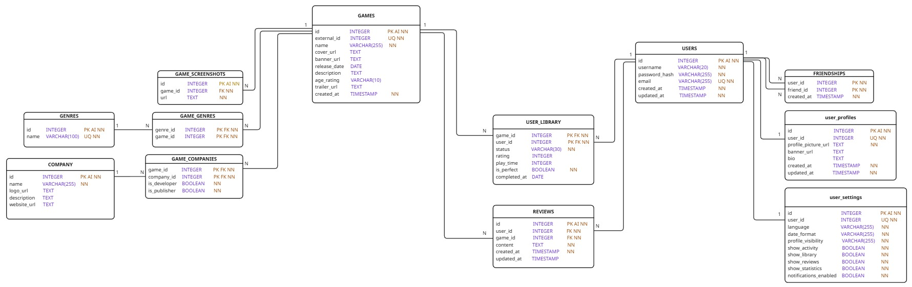

# Database Design

The GameShelf database was designed using a relational database model, with PostgreSQL as the database management system.

## Why a Relational Database?

A relational database was chosen because data integrity and efficient querying are essential to the GameShelf. The application relies on consistent relationships between users, games, user libraries, ratings, reviews, genres, and companies, while many features require queries that combine and aggregate data from multiple entities. A relational database allows these relationships and integrity constraints to be enforced at the database level, while providing an efficient and structured way to query this data. Since the GameShelf currently has no requirements that would justify the additional complexity of a NoSQL approach, a relational model is a more suitable choice for the project.

## Why PostgreSQL?

PostgreSQL was chosen because it is sufficient for the current requirements of the GameShelf while offering a rich set of features for querying and data manipulation. It provides the relational capabilities required by the application, along with advanced support for complex queries, aggregations, and extensibility. This provides flexibility to accommodate more complex data requirements as the project evolves, without introducing unnecessary complexity at its current stage.

## Database Architecture

The following diagram represents the planned database architecture of the GameShelf. It provides a visual overview of the entities, relationships, and main constraints defined for the application.

The architecture was designed before the database implementation, allowing the project's data structure and relationships to be defined in advance.

[View the interactive diagram in Miro](https://miro.com/app/board/uXjVHiXAC0c=/?share_link_id=920996169899)

The diagram represents the database architecture, while the actual database schema is implemented incrementally through Flyway migrations.