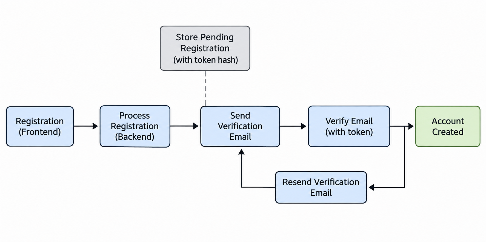
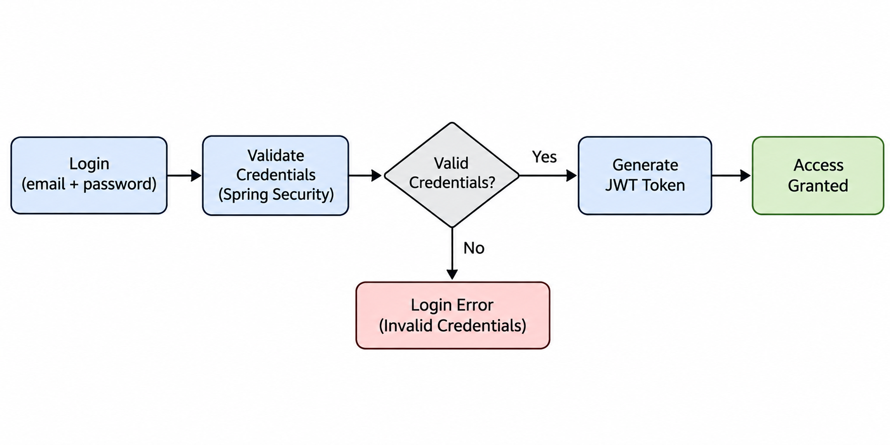

# Authentication and Security

## 1. Overview

The GameShelf authentication system manages user accounts and controls access to protected application resources. Its implementation covers the complete account lifecycle, including registration, email verification, login, and password recovery. The architecture combines Spring Security and JWT-based authentication, with PostgreSQL for persistence and a dedicated email service for account verification and password recovery. The main objectives are to protect user credentials, validate account operations, and provide a maintainable foundation for features that require authenticated users.

## 2. Architecture

The authentication system is divided between the React frontend and the Spring Boot backend. Each side has distinct responsibilities, keeping user interaction separate from authentication rules and data management.

### 2.1 Application Structure

The frontend handles forms, input validation, and communication with the backend. Authentication requests are centralized in a dedicated service that uses Axios, avoiding duplicated HTTP logic across page components. React Hook Form manages form state and submissions, while Zod validates user input before requests are sent.

The backend follows a layered architecture:

| Layer | Responsibility |
|---|---|
| Controller | Receives HTTP requests and returns responses |
| Service | Coordinates authentication and business logic |
| Repository | Handles database operations |
| Entity | Represents persisted application data |
| DTO | Defines request and response structures |
| Config | Contains security and application configuration |

This separation keeps authentication rules out of the HTTP layer and database access out of the business logic. It also makes individual components easier to maintain and test.

## 3. Password Security

Password protection is handled through a custom `PepperPasswordEncoder`, combining a secret pepper with Spring Security's Argon2 password encoder. This mechanism is used throughout the account lifecycle, including registration and password recovery.

### 3.1 Argon2 Password Hashing

The application uses `Argon2PasswordEncoder.defaultsForSpringSecurity_v5_8()`. Argon2 was selected over alternatives such as BCrypt because it is a memory-hard password hashing algorithm. In addition to computational cost, it requires a configurable amount of memory during password verification. This increases the cost of large-scale password guessing, particularly when attackers use highly parallel hardware. BCrypt remains a well-established password hashing algorithm. The choice of Argon2 reflects the preference for a memory-hard approach in this implementation.

### 3.2 Pepper

A pepper is an additional secret value used by the password encoder. Unlike a salt, which is generated for individual password hashes and stored with them, the pepper is shared by the application and kept outside the database. GameShelf loads this value through the `PASSWORD_PEPPER` environment variable.

Keeping the pepper outside the database adds another layer of protection if database records are exposed. An attacker would also need access to the application secret to reproduce the password verification process. The pepper must remain consistent with existing password hashes. Changing it without a migration strategy can prevent existing users from authenticating.

### 3.3 Password Requirements

The backend validates passwords with a length requirement of 8 to 128 characters. The frontend applies the same requirement through Zod, providing immediate feedback before submission. Backend validation remains authoritative because client-side validation can be bypassed.

## 4. Registration and Email Verification

Registration is divided into two stages: creating a pending registration and activating the account after email verification. This prevents incomplete registrations from being treated as active user accounts.

### 4.1 Registration Flow




When a user submits the registration form, the backend validates the supplied information and processes the password using the configured password encoder. A verification token is generated using 32 cryptographically secure random bytes and encoded using URL-safe Base64.

The backend calculates the token's SHA-256 hash and stores the registration information in the `pending_registrations` table, including the username, email, encoded password, token hash, and expiration timestamp. The verification token expires after 15 minutes. The original token is included in the verification email, while only its hash is persisted. This means that the database does not contain a directly usable verification token.

### 4.2 Email Verification

The verification process is handled by:

`POST /auth/verify-email`

The frontend submits the token received through the verification link. The backend calculates its SHA-256 hash and searches for the corresponding pending registration. After finding the record, the backend checks its expiration and verifies that the email has not already been registered. If validation succeeds, the application creates the user account in the `users` table. The previously encoded password is transferred to the new user record, and the default user role is assigned. Finally, the pending registration is deleted.

These database operations are performed within a transaction, ensuring that account creation and pending registration removal succeed together.

### 4.3 Resending Verification Emails

Users can request another verification email through:

`POST /auth/resend-verification-email`

The backend generates a new token, calculates its hash, updates the pending registration, and sets a new expiration timestamp. The previous token becomes invalid because its stored hash is replaced. This keeps only the latest verification token associated with the pending registration valid.

## 5. JWT Authentication

GameShelf uses JSON Web Tokens to authenticate users after login. The implementation uses Spring Security with a stateless session configuration, so authentication is established through the token included in each protected request rather than through an HTTP session maintained by the server.

### 5.1 Login and Token Generation



Login is handled by:

`POST /auth/login`

The frontend submits the user's email and password. The backend delegates credential verification to Spring Security's `AuthenticationManager`. The configured `UserDetailsService` retrieves the user using the email address, while the password encoder verifies the submitted password against the stored hash. After successful authentication, `JwtService` generates a signed JWT.

### 5.2 Token Structure and Expiration

The token contains the following claims:

| Claim | Description |
|---|---|
| `sub` | User's email address |
| `userId` | Unique user identifier |
| `iat` | Token issuance timestamp |
| `exp` | Token expiration timestamp |

The token is signed using the HMAC256 algorithm and a secret provided through the `TOKEN_SECRET` environment variable. Its expiration is set to 24 hours. The signing secret must be sufficiently strong for HMAC256 and must never be committed to version control.

### 5.3 Token Validation

Protected requests must include the JWT in the HTTP Authorization header:

```http
Authorization: Bearer <token>
```

The `SecurityFilter`, implemented using Spring Security's `OncePerRequestFilter`, intercepts requests and checks for a Bearer token. When a token is present, `JwtService` verifies its signature and expiration. If validation succeeds, the filter extracts the user's email and loads the corresponding user through `UserDetailsService`. The filter then creates an authenticated `UsernamePasswordAuthenticationToken` and stores it in Spring Security's `SecurityContextHolder`.

This allows the rest of the Spring Security chain to recognize the authenticated user when evaluating access to protected resources. If the token is missing, invalid, or expired, the request does not receive an authenticated security context. Protected endpoints therefore reject the request unless valid authentication is established.

### 5.4 Stateless Session Management

The security configuration uses:

`SessionCreationPolicy.STATELESS`

With this configuration, the application does not rely on HTTP sessions to preserve authentication between requests. Each request carries its own JWT, which is independently validated by the backend. This removes the need for shared session storage when running multiple backend instances and provides a straightforward foundation for horizontal scaling.

### 5.5 Authorization

Authentication and authorization are handled separately. Authentication establishes the identity of the user through the JWT. Authorization determines whether that authenticated user is allowed to access a particular resource. The current security configuration explicitly permits the authentication endpoints required by unauthenticated users, including registration, login, email verification, and password recovery. Other requests require authentication by default through:

`.anyRequest().authenticated()`

This establishes a protected-by-default approach for backend endpoints.

## 6. Password Recovery

Password recovery uses temporary tokens delivered to the user's registered email address. The process is divided into requesting a reset and submitting a new password.

### 6.1 Password Recovery Request

The recovery endpoint is:

`POST /auth/forgot-password`

The frontend submits the user's email address. If an account with that email exists, the backend deletes any previous password reset tokens associated with the user, generates a new random token, calculates its SHA-256 hash, and stores the new record in `password_reset_tokens`. The token expires after 15 minutes.

The original token is sent through the password recovery email, while only its hash is stored in PostgreSQL. The endpoint returns a generic response regardless of whether the supplied email belongs to an existing account. This prevents the response from revealing which email addresses are registered in GameShelf.

### 6.2 Resetting the Password

The reset endpoint is:

`POST /auth/reset-password`

The frontend submits the recovery token and the new password. The backend hashes the received token and searches for a matching record. It then checks whether the token exists and has not expired. If validation succeeds, the new password is encoded using the configured password encoder. The user's password and modification timestamp are updated, and the used reset token is deleted.

The operation is transactional, keeping the password update and token removal consistent. The password confirmation field is handled exclusively by the frontend. Its purpose is to check whether the user entered the intended password correctly; the backend only needs the new password itself.

## 7. Database Design

Authentication-related information is distributed across separate tables according to its purpose. This keeps permanent account information separate from temporary operations such as registration verification and password recovery.

### 7.1 Users

The `users` table stores active user accounts.

Its main fields include:

| Field | Description |
|---|---|
| `id` | Unique user identifier |
| `username` | Unique username |
| `email` | Unique email address |
| `password_hash` | Encoded password |
| `role` | Application user role |
| `created_at` | Account creation timestamp |
| `updated_at` | Last modification timestamp |

The username and email fields have uniqueness constraints to prevent duplicate accounts.

### 7.2 Pending Registrations

The `pending_registrations` table stores registration information before account activation. It includes the registration data required to create the user after successful email verification, together with the verification token hash and expiration timestamp. Once verification succeeds, the corresponding record is removed.

### 7.3 Password Reset Tokens

The `password_reset_tokens` table stores temporary password recovery information. Each record is associated with a user and contains the token hash and expiration timestamp. Separating reset tokens from the `users` table avoids adding temporary recovery information to the permanent account structure.

## 8. Environment Configuration

Sensitive values and environment-specific settings are supplied externally rather than being hardcoded into the application. The authentication implementation depends on the following environment variables:

| Variable | Purpose |
|---|---|
| `PASSWORD_PEPPER` | Secret used by the password encoder |
| `TOKEN_SECRET` | Secret used to sign JWTs |

The relevant YAML configuration is:

```yaml
spring:
  application:
    name: backend

  security:
    pepper: ${PASSWORD_PEPPER}

  jwt: ${TOKEN_SECRET}
```

Database and email settings are configured separately according to the active environment.

### 8.1 Email Development Environment

Mailpit is used during development to capture emails sent by the backend. It provides a local SMTP environment and an interface for inspecting messages without delivering them to real recipients. This makes it possible to verify the registration and password recovery email flows during development. For production, Mailpit must be replaced by an appropriate email delivery provider.

## 9. Conclusion

The GameShelf authentication system combines email verification, password hashing, temporary tokens, and JWT-based authentication to manage user access. Its architecture separates permanent account data from temporary authentication operations and keeps responsibilities distributed across the frontend, backend, and persistence layers. The resulting implementation provides a foundation for the application's authenticated features while allowing the security mechanisms to evolve independently as new requirements are introduced.